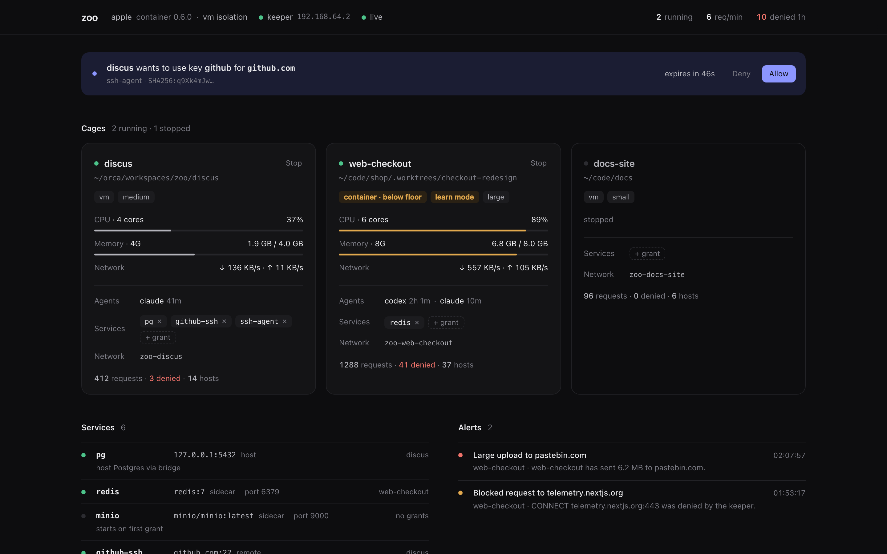

# zoo

Run AI coding agents in small VMs ("cages") whose only way out is a logging, allowlisting proxy ("the keeper"), and watch everything on a live dashboard.

- **Cage:** one sandbox per worktree: an Apple `container` VM, or a Docker/Podman container. Your worktree is shared in; nothing else from your machine is.
- **Keeper:** squid in its own small VM or container. Cages sit on an internal network with no internet, so the keeper is the only route out. Default-deny allowlist, every request logged.
- **Dashboard:** what's running, CPU and memory per cage, and a live network feed with search and filters, on `http://127.0.0.1:7777`.

Works with any CLI agent (Claude Code, Codex, pi, opencode, …) and any tool that launches them (Conductor, Orca, herdr, your terminal).



How it fits together, with the trust boundaries and sequence diagrams: [docs/overview.html](docs/overview.html) (open it locally) or the [architecture diagram](docs/images/architecture.png).

## Requirements

One of these backends:

| Backend | Runs on | Isolation | Notes |
|---|---|---|---|
| `apple` | macOS 26+, Apple silicon, [`container`](https://github.com/apple/container/releases) | `vm`: a VM per cage | Default when installed. |
| `docker` | OrbStack, Docker Desktop, colima, Docker Engine (macOS or Linux) | `container`: cages share one kernel | Set `docker.runtime: kata` (`microvm`) or `runsc` (`sandboxed-container`) on Linux for more. |
| `podman` | Podman (machine on macOS, native on Linux) | `container` | Same driver as docker. |

Go 1.24+ to build from source.

### Picking a backend and the isolation floor

`zoo backend` lists what's installed, running, and how strong each is. `auto` (the default) picks the strongest ready backend that meets your **isolation floor**.

The floor defaults to `microvm`: zoo refuses to start cages that share a kernel with each other unless you say so. Plain Docker/OrbStack/Podman cages are `container` isolation, so to use them:

```sh
zoo up --backend docker --isolation-floor container   # remembered for later commands
# or in ~/.zoo/config.yaml:
#   backend: docker
#   isolation_floor: container
# or once: zoo run --allow-weaker-isolation claude   (the cage is marked "below floor")
```

The isolation level is shown in `zoo ls`, `zoo status`, `zoo doctor` and on every dashboard card. `zoo backend use <name>` switches the default; cages on the old backend stay where they are.

## Install

```sh
brew install dustywusty/tap/zoo                 # macOS and Linux
```

Debian/Ubuntu and Fedora/RHEL packages, and tarballs for darwin and linux (amd64, arm64), are on the [releases page](https://github.com/dustywusty/zoo/releases/latest):

```sh
sudo dpkg -i zoo_<version>_linux_amd64.deb      # or: sudo rpm -i zoo_<version>_linux_amd64.rpm
```

zoo needs a container runtime (see Requirements). From source: `go build -o ~/.local/bin/zoo ./cmd/zoo`.

### Verify a download

```sh
sha256sum --check --ignore-missing checksums.txt
gh attestation verify zoo_<version>_linux_amd64.tar.gz --repo dustywusty/zoo     # build provenance
cosign verify-blob checksums.txt --bundle checksums.txt.sigstore.json \
  --certificate-identity-regexp 'https://github.com/dustywusty/zoo/\.github/workflows/release\.yml@refs/tags/v.*' \
  --certificate-oidc-issuer https://token.actions.githubusercontent.com
```

## Quickstart

```sh
zoo up                      # first run builds the cage + keeper images (a few minutes)

claude setup-token          # on your Mac: a long-lived token for Claude Code
zoo keys set claude         # paste it; stored in your Keychain

cd ~/src/your-repo
zoo doctor                  # proves the walls hold from inside a cage
zoo run claude              # Claude Code, caged
zoo dash                    # open the dashboard
```

`zoo run` creates (or reuses) the cage for the current git worktree, then runs the agent inside it as an unprivileged user. Run it again in the same worktree and you join the same cage; that's how several agents share one.

## Commands

| Command | Does |
|---|---|
| `zoo up` / `zoo down [--all]` | Start / stop the keeper and dashboard (`--all` also stops cages) |
| `zoo run [harness] [--size S] [-- args]` | Run an agent in this worktree's cage. Default harness: `claude` |
| `zoo shell [cage]` | Bash in a cage |
| `zoo ls` | List cages |
| `zoo stop <cage\|all>` / `zoo reset <cage>` | Stop a cage / delete it so the next run starts clean |
| `zoo allow [--for 4h] <host…>` / `zoo deny <host…>` / `zoo allowlist` | Edit the allowlist (`.example.com` = domain + subdomains). `--for` makes an entry lapse (30m, 4h, 2d) |
| `zoo blocked [cage]` | Hosts the keeper refused that aren't allowlisted: your approval queue |
| `zoo keys set\|rm <name>` / `zoo keys ls` | Harness credentials in the Keychain |
| `zoo shims install` | PATH shims so other tools land in cages |
| `zoo doctor [--deep] [--json] [cage]` | Check every wall from inside a cage. `--deep` also scans the cage's /24 and well-known private addresses, directly and through the keeper (~10 s); `--json` prints one `{verdict, check, detail}` per line for CI |
| `zoo trust [path] [--show]` | Approve this worktree's `zoo.yaml` (agents can edit it, so zoo only uses what you approved) |
| `zoo service ls` / `zoo grant [--for 4h] <cage> <name>` / `zoo revoke <cage> <name>` | Services and credentials a cage can be given, for a while or for good |
| `zoo ports [cage]` / `zoo open [cage] [port]` | Dev servers listening in a cage, and their preview URLs |
| `zoo ssh setup` / `zoo ssh [cage] [cmd…]` | SSH into cages, for editors (no listener: it runs over the runtime's exec) |
| `zoo build [cage\|keeper]` | Rebuild images (then `zoo reset` cages to pick it up) |
| `zoo backend [list\|use <name>]` | Show backends, their isolation and readiness; pick one |
| `zoo status` | Backend, isolation, keeper, dashboard, shims at a glance |
| `--backend B`, `--isolation-floor L`, `--allow-weaker-isolation` | Global flags for any command |

### Sizes

| Size | CPUs | Memory | Processes |
|---|---|---|---|
| `tiny` | 1 | 1 GiB | 512 |
| `small` (default) | 2 | 2 GiB | 1024 |
| `medium` | 4 | 4 GiB | 2048 |
| `large` | 6 | 8 GiB | 4096 |

`--size 3:6G` for a one-off. Per repo: `size: medium` in `zoo.yaml`. Changing size restarts the cage; the worktree is untouched. Define your own under `sizes:` in `~/.zoo/config.yaml`.

### Per-repo `zoo.yaml` (optional)

```yaml
size: medium
mask: ["config/*.secret.json"]   # extra files to hide inside the cage
unmask: [".env.test"]            # files the defaults would hide but this repo needs
services: [pg, github]           # services and credentials this repo's cage gets
mounts: [../infra, ~/src/web]    # more worktrees in the same cage (masked and git-guarded too)
git: rw                          # rw (default) | ro: history read-only | none: no .git in the cage
```

**zoo only uses a `zoo.yaml` you approved.** It sits in the worktree, which the agent can write, and it can grant services and unmask files. So the file on disk is a proposal: `zoo run` from a terminal shows what changed and asks; anywhere else zoo keeps the last approved copy and warns. `zoo trust` approves it explicitly, `zoo trust --show` prints what's in effect. Mounts, masks and `git:` apply when a cage is created (`zoo reset <cage>`); grants apply at once.

`mounts:` can't name `/`, your home, a parent of the worktree, or anything overlapping `~/.ssh`, `~/.aws`, `~/.config`, `~/Library` and similar.

## What a cage can and can't do

| | |
|---|---|
| Read/write your worktree | Yes |
| See `.env*`, `*.pem`, `*.key`, `id_*`, `.npmrc`, `.netrc` in the worktree | No: replaced by empty read-only files |
| Write `.git/hooks` or `.git/config` (things that run on your Mac later) | No: read-only, and `.git` can't be renamed to get around that |
| Write hooks somewhere git config points into the worktree (`core.hooksPath=.husky`, `include.path`, filter scripts) | No: those paths are read-only in the cage |
| Change `zoo.yaml` to grant itself services or unmask secrets | No: zoo only uses the copy you approved |
| Redirect another worktree's git, or a submodule's (`.git/worktrees/*`, `.git/modules`) | No: read-only; only this worktree's own gitdir is writable |
| Plant a repository in the worktree (`sub/.git`, a bare repo, a `.git` file pointing elsewhere) | Can't be blocked, so it's caught: `zoo run` warns when the session ends, the dashboard alerts within 30 s, `zoo doctor` fails. Don't run git in a flagged dir; delete it |
| Reach your Mac, LAN, tailnet or cloud metadata through the keeper | No: private, loopback, link-local and CGNAT addresses are refused even for allowlisted names |
| Reach your LAN, tailnet (100.100.100.100) or cloud metadata (169.254.169.254) directly | No: internal network, no route; `zoo doctor --deep` probes them |
| Reach other cages directly | Docker/Podman: no, each cage has its own network. Apple: cages share a network, so `zoo doctor --deep` warns about anything listening on it |
| Bring up a VPN (WireGuard, Tailscale, tun) to route around the keeper | No: no capabilities to create interfaces; `zoo doctor` fails on any interface besides lo and the cage's own, or a default route (warns on Apple) |
| Use a granted service by forging another cage's address | No: the gate checks which keeper address each connection arrives on, and the Docker keeper drops reverse-path-invalid packets |
| Gain capabilities, run setuid binaries | No: every capability dropped; agents run as an unprivileged user |
| Reach the internet directly | No: internal network, no DNS |
| Reach allowlisted hosts | Yes, through the keeper, logged |
| Reach other hosts | No: denied and logged, alert on the dashboard |
| See your home dir, SSH keys, cloud creds, Keychain | No |
| Push to GitHub | Not by default: agents commit, you push. With a `credentials:` entry: only the branches you list (`push: ["agent/*"]`) |
| See your GitHub token or model key | Not with `credentials:`: the cage holds a placeholder, the keeper adds the real value on the way to its hosts |

By default the agent's model token is inside the cage. To keep it in the keeper too, see [Credentials](#credentials-that-never-enter-a-cage). Either way, use a dedicated token you can revoke.

## Using it with other tools

zoo catches agents through three doors. No tool needs to know zoo exists.

**1. Shims (anything that spawns a local CLI)**

```sh
zoo shims install
# then, as the LAST line of ~/.zshrc and ~/.zprofile:
export PATH="$HOME/.zoo/shims:$PATH"
```

Now `claude` and `codex` anywhere on your Mac run inside the right cage. `ZOO=off claude` runs the real one.

- **Conductor** and **herdr**: spawn `claude`/`codex` in their worktrees, so the shim catches them. If an app doesn't see the shim (GUI apps don't always read your shell's PATH), point its agent/CLI path setting at `~/.zoo/shims/claude`. Quit and reopen the app after changing PATH.
- **Your terminal / scripts**: just works.

**2. Direct**

`zoo run codex`, `zoo run claude -- -p "fix the tests"`, `zoo shell`.

**3. More harnesses**

Add any CLI agent in `~/.zoo/config.yaml`, then `zoo shims install` again:

```yaml
harnesses:
  pi:
    command: pi
    env: { ANTHROPIC_API_KEY: anthropic }    # ENV_VAR: keychain item (zoo keys set anthropic)
    allow: [api.anthropic.com]               # hosts it needs, added on first run
  opencode:
    command: opencode
```

The CLI must be installed in the cage image: add it to `assets/images/cage/Dockerfile`, rebuild `zoo`, then `zoo build cage` and `zoo reset` any existing cages.

**Orca:** v0 works through shims for local tabs. SSH access into cages (so Orca's remote mode can target a cage directly) is on the phase 3 list.

### Harness notes

| Harness | Credential | Notes |
|---|---|---|
| Claude Code | `claude setup-token` → `zoo keys set claude` | Non-essential traffic and auto-update are off inside cages |
| Codex | `zoo keys set codex` (API key), or `zoo keys set codex-auth < ~/.codex/auth.json` (ChatGPT login) | |
| Anything else | `env:` mapping in config | Network, resources and file safety work for every harness |

## Credentials that never enter a cage

Give agents GitHub (or any HTTPS API) without giving them the token:

```yaml
# ~/.zoo/config.yaml
credentials:
  github:
    hosts: [github.com, api.github.com]
    secret: github-pat          # zoo keys set github-pat  (or bw:item, op://vault/item/field)
    env: [GH_TOKEN, GITHUB_TOKEN]
    git: true                   # git over https uses it; ssh remotes are fetched over https in the cage
    readonly: true              # reads only: GET, GraphQL queries, git fetch, LFS download…
    push: ["agent/*"]           # …plus git push to these branches
    repos: [you/app]            # …in these repositories
```

```sh
zoo grant --for 4h api-3fa2c1 github     # or services: [github] in zoo.yaml, or the dashboard
```

The cage gets a placeholder like `zoocred.github.api-3fa2c1.9c1e…` in `GH_TOKEN` and from git's credential helper. It's bound to that cage and credential (an HMAC only your machine knows), so it's useless anywhere else. For the credential's hosts only, the keeper terminates TLS, swaps the placeholder for the real token (zood reads it from your Keychain or vault when asked, and refuses if the grant is gone), checks the policy, and re-encrypts to GitHub with normal certificate checks. `gh run view --log` works; `git push origin main` gets a 403 from the keeper; so does `gh gist create`, even with a token the attacker supplies, because the policy applies to every request to those hosts.

To keep the model token out of the cage as well:

```yaml
harnesses:
  claude: { command: claude, env: { CLAUDE_CODE_OAUTH_TOKEN: "cred:claude" } }
  codex:  { command: codex,  env: { OPENAI_API_KEY: "cred:codex" } }
```

How the keeper does it: squid routes only credential hosts to an injector inside the keeper; every other host stays an opaque CONNECT tunnel. The keeper's CA is generated per install and name-constrained to exactly the credential hosts (so even its key can't mint a certificate for anything else); it's added to cages' trust stores, and `NODE_EXTRA_CA_CERTS`, `SSL_CERT_FILE` and `REQUESTS_CA_BUNDLE` point at it. Use a fine-grained token scoped to the repos you mean: `repos:` narrows REST and git paths, but GraphQL can't be narrowed by path. `zoo service ls` lists credentials and who holds them; `~/.zoo/keeper/log/inject.log` has one line per request (never the value).

## Previewing dev servers

Each cage's dev servers are reachable from your browser, even when the host can't route to the cage:

    http://<cage>.localhost:7779          the cage's lowest listening port (e.g. Vite on 5173)
    http://<port>.<cage>.localhost:7779   a specific port

    zoo ports [cage]          what's listening, with URLs
    zoo open [cage] [port]    open it (default: this worktree's cage)

The dashboard shows the same links on each cage card, so two agents' versions of the app sit side by side without port juggling. zood serves these on 127.0.0.1 only and answers only for `*.localhost` names of running cages; each connection runs `socat` inside the cage (over the runtime's exec) to the dev server's loopback port. `preview_port:` in `~/.zoo/config.yaml` changes the port; `0` turns previews off.

Chrome and Firefox resolve `*.localhost` themselves; Safari on recent macOS does too (older releases: add `127.0.0.1 <cage>.localhost` to `/etc/hosts`). If a dev server rejects the host name, allow `.localhost` (Vite already does; Next.js: `allowedDevOrigins`).

## SSH and editors

Editors that work over SSH (VS Code / Cursor Remote-SSH, JetBrains Gateway, Orca's remote mode) can open a cage directly:

```sh
zoo ssh setup          # writes ~/.zoo/ssh/config and a key in ~/.zoo/ssh/
```

Add the line it prints at the **top** of `~/.ssh/config` (`Include ~/.zoo/ssh/config`), then `ssh zoo-<cage>` or pick `zoo-<cage>` in your editor. `zoo ssh [cage] [cmd…]` works without touching `~/.ssh/config`.

Nothing listens on any port: ssh runs `zoo ssh-proxy <cage>`, which starts the cage if needed and runs a one-shot `sshd` inside it as `agent` over the runtime's exec. You get the same keeper, allowlist and services as `zoo run`, but not the model credentials. The cage's sshd config and authorized key are root's; agent forwarding, X11, remote (`-R`) and socket forwarding are refused; local forwarding (`-L`) stays on because editors use it.

**Editor settings (required):** your editor trusts the server it connects to, and in a cage the agent controls it. In VS Code / Cursor set `"remote.SSH.enableAgentForwarding": false`, `"github.gitAuthentication": false`, `"git.terminalAuthentication": false` and `"git.useIntegratedAskPass": false`, or git in the cage gets answered from your desktop's credentials. `"remote.SSH.localServerDownload": "always"` avoids allowlisting Microsoft's download hosts. JetBrains Gateway downloads its backend from inside the cage: allowlist its hosts (`zoo blocked` shows them). New cages need this release's image: `zoo reset <cage>`.

## Dashboard

`zoo dash` opens `http://127.0.0.1:7777`.

- **Cages:** status, size, live CPU / memory / network against limits, attached agents, request and deny counts. Stop button.
- **Network:** every request from every cage, live. Search box (`/` to focus) matches host, URL, cage, method and status; `-term` excludes. Filter by cage and by All / Allowed / Denied / New hosts. Pause freezes the feed while you read. **Allow** on a blocked row adds that host for every cage, for as long as you say (empty = for good).
- **Grants:** `+ grant` on a cage gives it a service or credential, again for a while or for good; temporary ones show the time left.
- **Preview:** links to each cage's listening dev servers.
- **Alerts:** blocked requests, a repository planted in a worktree, any cage that uploads more than 5 MB to one host (`bytes_out_alert` in config), and temporary allows and grants lapsing. Set `ntfy_url` to get them on your phone.

It listens on 127.0.0.1 only; changes need a per-install token, so other web pages can't drive it.

## First run in a new repo

When zoo creates a cage it lists anything in the repository that runs commands when **you** use git on your Mac: hooks in `.git/hooks`, and config like `core.fsmonitor`, `core.hooksPath`, filters, `include.path`. A repo that arrived as a zip ("take-home assignment") can carry a hook that runs a payload at your first commit; check the list before you trust it. `zoo doctor` shows it too. For repos you don't trust at all, `git: none` in `zoo.yaml` keeps `.git` out of the cage, and `git: ro` lets the agent read history without changing it.

There's no allow-everything mode: every host is approved by hand. Run the agent, let it hit walls, and approve what you trust, either with **Allow** on a red row in the dashboard or from the terminal:

```sh
zoo blocked            # hosts refused that aren't on the allowlist, most-requested first
zoo allow <the ones you trust>
```

Approvals apply to running cages immediately; the agent just retries.

## Files

| Path | What |
|---|---|
| `~/.zoo/config.yaml` | Global config (sizes, masks, harnesses, alerts) |
| `~/.zoo/keeper/etc/allowlist.txt` | The allowlist, one host per line |
| `~/.zoo/keeper/log/access.log` | Every request through the keeper |
| `~/.zoo/daemon.log` | Dashboard daemon log |

## Known gaps

- **Your Mac's open ports are visible to cages.** On an internal network the host gateway is still reachable ([apple/container#1320](https://github.com/apple/container/issues/1320)), so anything on your Mac bound to `0.0.0.0` is reachable from a cage. `zoo doctor` lists them. Common culprit: AirPlay Receiver (ports 5000/7000): turn it off in System Settings → General → AirDrop & Handoff. Bind dev servers to `127.0.0.1`.
- **Allowed hosts can still carry data out** (e.g. a gist on github.com, using a token the attacker supplies). A `credentials:` entry with `readonly: true` closes that for its hosts; elsewhere the bytes-out alert is the tripwire, and it won't notice a few KB.
- **Branches are shared.** The cage writes the repo's refs, so an agent can move any branch (`main`, or `origin/*` so it looks pushed). Check `git log` before you push something you didn't watch it make, or use `git: ro`. Pushes through a `credentials:` entry are limited to its `push:` branches.
- **Planted repositories are detected, not prevented.** The dashboard scans every 30 s, so a shell prompt or editor running git in the worktree *while* the agent works can beat it. Setting `safe.bareRepository=explicit` in your global git config closes the bare-repo variant for good.
- **Submodules are read-only in cages** (`.git/modules`): update them on the host.
- **Attribution is per cage**, not per agent, when several agents share a cage.
- **Masks are fixed when a cage is created.** A secret file added on the host later is hidden after `zoo reset`. On Apple, edits you make to `.git/config` on the host also show up in the cage only after `zoo reset` (the cage sees a read-only copy).
- **Docker/Podman cages share a kernel** (isolation `container`), which is why the floor refuses them by default. On macOS that kernel is OrbStack's or Docker Desktop's VM, not your Mac's.
- **`nproc` inside a Docker cage shows all host CPUs**; the CPU limit is a quota, not a CPU set.
- **No disk limit per cage yet**, and no Docker-inside-the-cage yet.
- **Credential hosts are decrypted in the keeper.** That's how the keeper adds the token and enforces `readonly`/`push`; it happens only for hosts under `credentials:`, with a CA that can't sign for anything else. Pinned-certificate clients won't work against those hosts.

## Troubleshooting

- `zoo up` fails on `network create --internal`: needs macOS 26 and a recent `container` release.
- `zoo run` says the backend is below your isolation floor: see "Picking a backend" above.
- After upgrading zoo: `zoo up` builds the new images and replaces the keeper. Stopped cages are rebuilt on their next run; a running cage from an older zoo prints a warning: stop its agents and `zoo reset` it.
- Agent can't reach something it needs: look for the red row in the dashboard and click **Allow**, or `zoo allow host`.
- Cage files owned by the wrong user: the cage image uses your Mac uid/gid at build time; rebuild with `zoo build cage` and `zoo reset <cage>`.
- Dashboard empty: `cat ~/.zoo/daemon.log`, then `zoo down && zoo up`.

## Roadmap

1. Cage + keeper + basic dashboard; Apple and Docker/Podman backends; credentials, previews, SSH door ← you are here
2. Visibility: OTel collector + store, file watcher, resource history, phone alerts
3. Agent sessions: Claude Code / Codex OTel → AG-UI timelines, Tetragon in the guest, per-agent attribution, SSH into cages
4. Homelab + k8s: k3s + Kata on Proxmox, keeper as egress gateway, Helm chart
