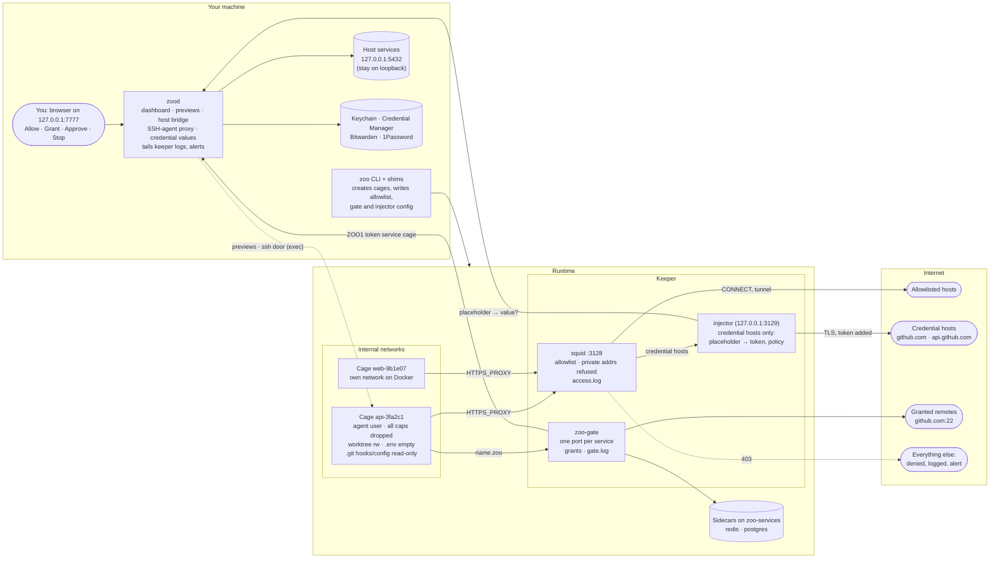
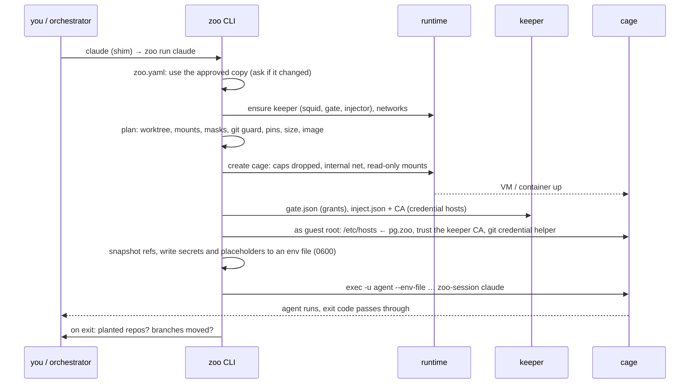
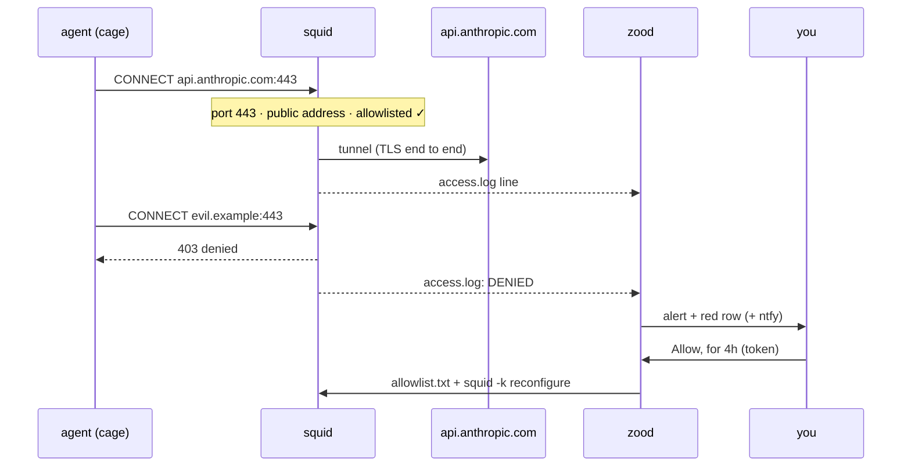
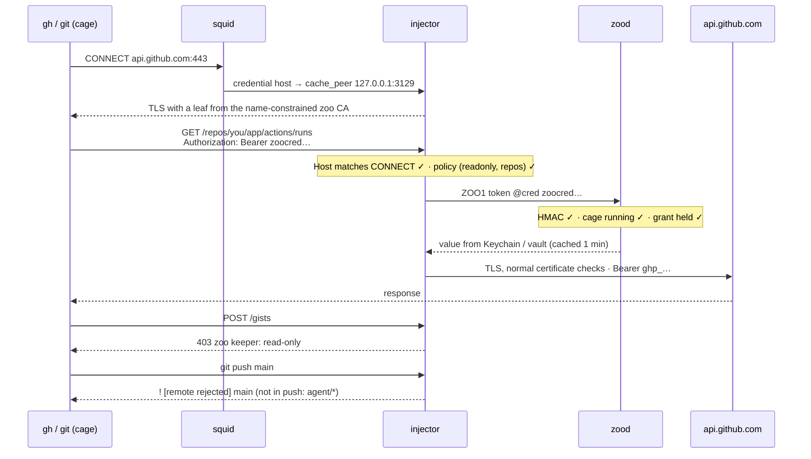
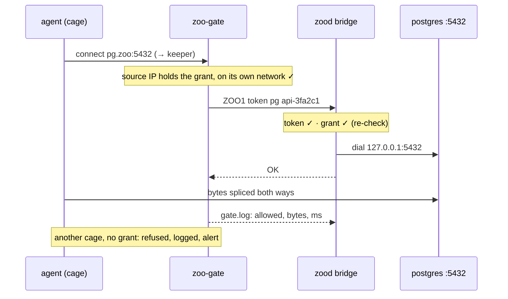
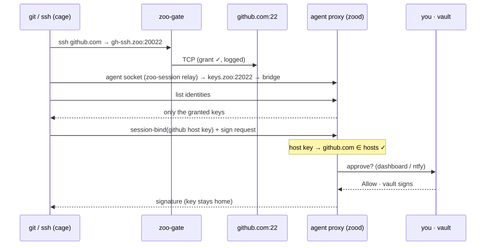
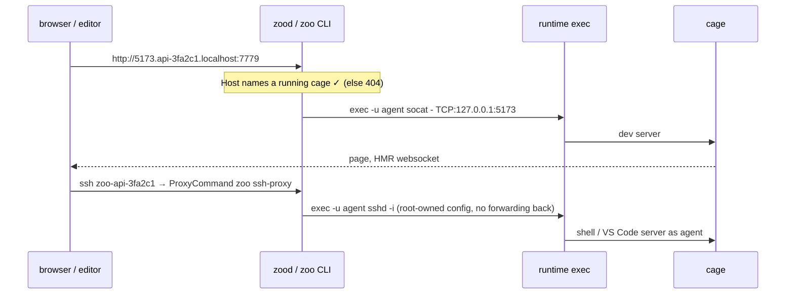

# Architecture

What can reach what, and how the pieces talk. For the narrative, see [How it works](how-it-works.md); for the reasons behind each choice, the decision log in [BRIEF.md](BRIEF.md#15-decision-log).

## Trust boundaries

Each box is a trust boundary: your machine (trusted), the runtime (an Apple VM per cage, or Docker/Podman containers), the internal networks cages live on (no route out, no DNS), and the keeper, the only thing a cage can reach. Every arrow is the only path between two zones.

No arrow means no path: a cage can't reach the internet directly, DNS, your machine (except Apple's gateway, see below), other cages on Docker, or the dashboard.

## Boundaries

| From → to | Allowed | Enforced by |
|---|---|---|
| cage → internet | never directly | internal network: no default route, no DNS (`--no-dns` / `--dns 127.0.0.1`) |
| cage → web host | allowlisted only | squid `CONNECT` by hostname (`dstdomain -n`, no PTR tricks), ports 80/443 only, private, loopback and metadata addresses refused even for allowlisted names |
| cage → credential host | with policy | the injector: Host must match the CONNECT, `readonly` / `push` / `repos` checked, placeholder swapped for the real token from zood, re-encrypted with normal certificate checks |
| cage → service | granted only | zoo-gate: per-port allow list of cage IPs, checked against the keeper address the connection arrived on; zood re-checks the grant on the bridge |
| cage → your machine | Apple: gateway visible | Docker: unreachable. Apple: anything bound to `0.0.0.0` is reachable ([apple/container#1320](https://github.com/apple/container/issues/1320)); `zoo doctor` reports it. Host services go through the bridge, so they can stay on loopback |
| cage → other cage | Docker: no | Docker: one internal network per cage. Apple: shared network (no live network attach); `zoo doctor --deep` warns |
| cage → host files | worktree only | bind mount at the same path (Windows: `/c/…`), plus `zoo.yaml mounts:`; secrets masked; `.git` hooks, config, worktrees/, modules/ and worktree hook paths read-only; directories pinned against rename; planted repos and moved branches detected on the host |
| cage → `zoo.yaml` / Dockerfile | writes, not effect | zoo uses only the copy you approved (`zoo trust`, `zoo build --project`); Dockerfiles build with an empty context |
| cage → your keys | signatures, not keys | SSH-agent proxy: key filter, `session-bind` host check, optional approval, log; the key never leaves the vault |
| cage → credentials | placeholders | an HMAC-bound placeholder per cage and credential; without `credentials:`/`cred:`, the model token in a 0600 env file, never on argv |
| anything → dashboard | no | loopback bind, Host header check, token on writes; `zoo doctor` checks cages can't reach it |
| you → cage | over exec | previews and the SSH door run through the runtime's exec: no port is opened into or out of a cage |
| cage → its own kernel | depends | Apple: VM per cage. Docker: shared kernel, refused unless `isolation_floor: container`; shown on every card |

## Sequences

### `zoo run claude`

Shims make any orchestrator (Conductor, herdr, Orca, a terminal) land here without knowing about zoo. The cage persists per worktree; sessions come and go.

### Web request: allowed, denied, approved

Hostname-level control via `CONNECT`; TLS is end to end for every host not under `credentials:`.

### Credential: the token stays in the keeper

The cage holds `zoocred.github.api-3fa2c1.<hmac>`. Only for the credential's hosts does the keeper look inside the TLS session, with a CA that can't sign for anything else.

### Granted service: `pg.zoo`

The host's Postgres stays on 127.0.0.1. Only the keeper can reach the bridge's address, and only with the token; a cage without the grant is refused at the gate and logged.

### `git push` over SSH with your key

The private key never leaves Bitwarden or 1Password. The proxy only signs for hosts the service allows (checked against the server's host key via `session-bind`), and can ask you first.

### Previews and the SSH door

Neither opens a port. Both run through the runtime's exec, the same channel `zoo run` uses.

